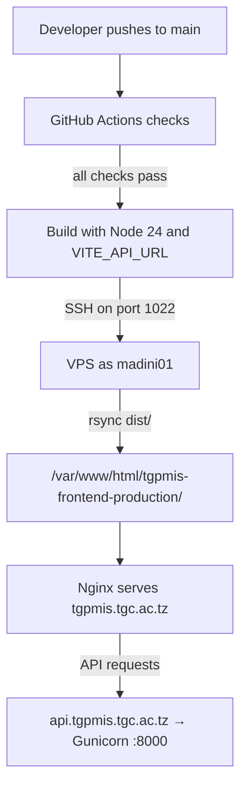
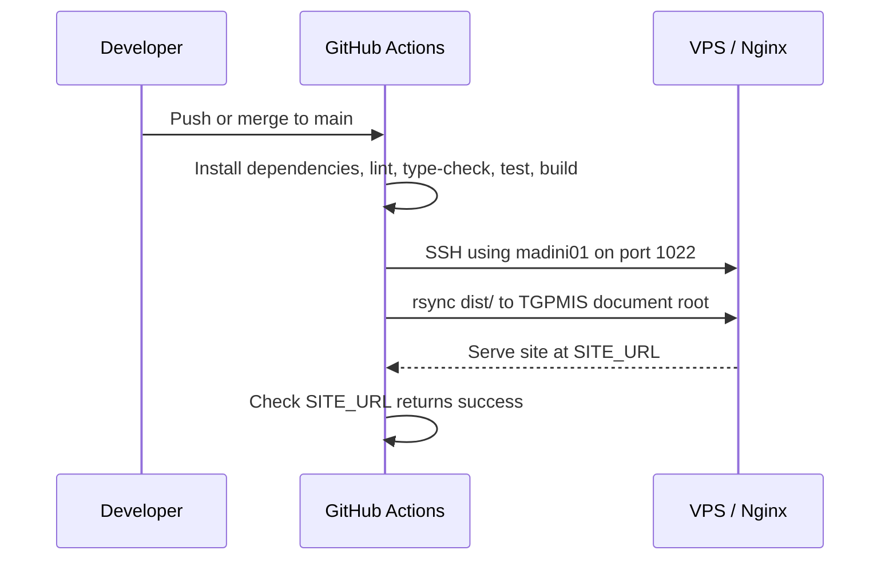

# Deployment

The app is a **static single-page application**. `pnpm build` produces `dist/`,
which any static host can serve — there is no Node server at runtime.

## TGPMIS production deployment

The production site is `https://tgpmis.tgc.ac.tz`. GitHub Actions builds the
frontend and uploads it to `/var/www/html/tgpmis-frontend-production/` on the
VPS. Nginx serves those files. The VPS does not need Node or PM2 for this
frontend deployment.



### 1. Prepare the VPS document root

The GitHub runner uploads only the built files. The Git checkout stays on the
build runner; Nginx serves the separate document root below. Ensure the
`madini01` account can update this directory and Nginx can read its files:

```bash
sudo chown -R madini01:madini01 /var/www/html/tgpmis-frontend-production
sudo find /var/www/html/tgpmis-frontend-production -type d -exec chmod 755 {} +
sudo find /var/www/html/tgpmis-frontend-production -type f -exec chmod 644 {} +
test -w /var/www/html/tgpmis-frontend-production && echo Writable
```

The workflow uses `rsync --delete` to remove obsolete hashed assets, but its
remote destination is fixed to this TGPMIS directory. The SSH key logs in as
`madini01`, so it has the access that account already has on the VPS; use a
separate account later if stronger isolation from the other projects is needed.

### 2. Give GitHub Actions SSH access

Use a dedicated key pair for the workflow. Do not reuse the key the VPS uses to
clone the GitHub repository: that key authenticates in the opposite direction.

On Windows PowerShell, create the key pair (leave the passphrase empty so the
non-interactive workflow can use it):

```powershell
ssh-keygen -t ed25519 -C "tgpmis-frontend-actions" -f "$env:USERPROFILE\.ssh\tgpmis-actions"
```

Copy only the `.pub` file to the VPS:

```powershell
scp -P 1022 "$env:USERPROFILE\.ssh\tgpmis-actions.pub" madini01@41.59.229.28:~/tgpmis-actions.pub
```

On the VPS, append the public key without replacing existing keys:

```bash
mkdir -p ~/.ssh
chmod 700 ~/.ssh
cat ~/tgpmis-actions.pub >> ~/.ssh/authorized_keys
chmod 600 ~/.ssh/authorized_keys
rm ~/tgpmis-actions.pub
```

Verify the new key can log in from PowerShell:

```powershell
ssh -i "$env:USERPROFILE\.ssh\tgpmis-actions" -p 1022 -o IdentitiesOnly=yes madini01@41.59.229.28
```

GitHub also needs a trusted host key. On the VPS, read and fingerprint its
public SSH host key:

```bash
sudo cat /etc/ssh/ssh_host_ed25519_key.pub
sudo ssh-keygen -lf /etc/ssh/ssh_host_ed25519_key.pub
```

Use the public key from the first command to form one `known_hosts` line by
prefixing `[41.59.229.28]:1022 ` (including one space). The second command
prints its fingerprint. The `ssh-keyscan` command on some Windows OpenSSH
clients may fail to negotiate with the VPS; do not use its banner or error as a
host key.

### 3. Configure the GitHub production environment

In the frontend repository, open **Settings → Environments** and create an
environment named `production`. Restrict it to the `main` branch; leave required
reviewers empty for automatic deployment.

Add these **environment variables**:

| Name | Value |
| --- | --- |
| `SSH_HOST` | `41.59.229.28` |
| `SSH_PORT` | `1022` |
| `SSH_USER` | `madini01` |
| `VITE_API_URL` | `https://api.tgpmis.tgc.ac.tz/api/v1` |
| `SITE_URL` | `https://tgpmis.tgc.ac.tz` |

Add these **environment secrets**:

| Name | Value |
| --- | --- |
| `SSH_PRIVATE_KEY` | Full contents of `tgpmis-actions`, including the begin/end lines; never commit or share it. |
| `SSH_KNOWN_HOSTS` | The verified `[41.59.229.28]:1022 ssh-ed25519 ...` line. |

The `VITE_API_URL` value is embedded in the browser bundle at build time. It is
public configuration, not a place for passwords or API secrets. The workflow
fails before deployment when required values are missing.

### 4. Route the API subdomain to TGPMIS

The API host must route the frontend's API paths to the new Gunicorn service.
In the HTTPS server block for `api.tgpmis.tgc.ac.tz`, replace the legacy
`/billing/` location with the following. Keep the server's existing TLS
certificate directives and its `location / { return 403; }` fallback:

```nginx
location ~ ^/(api|admin|gepg|verify|billing)(/|$) {
    proxy_pass http://127.0.0.1:8000;
    proxy_set_header Host              $host;
    proxy_set_header X-Real-IP         $remote_addr;
    proxy_set_header X-Forwarded-For   $proxy_add_x_forwarded_for;
    proxy_set_header X-Forwarded-Proto $scheme;
    proxy_redirect off;
}
```

This replaces the old `/billing/` backend route for that API hostname. Before
reloading Nginx, check and apply the configuration:

```bash
sudo nginx -t
sudo systemctl reload nginx
```

In the TGPMIS backend's VPS `.env`, ensure `ALLOWED_HOSTS` includes
`api.tgpmis.tgc.ac.tz` and `CORS_ALLOWED_ORIGINS` includes the browser's origin,
`https://tgpmis.tgc.ac.tz`. Preserve any other required entries. Restart the
TGPMIS Gunicorn service after changing its environment.

### 5. Deploy and verify

The workflow in [`.github/workflows/ci.yml`](../.github/workflows/ci.yml) runs
the checks on pull requests and pushes to `main`/`master`. It deploys only for a
push to `main`, and only after its checks pass:



After the workflow changes are committed and merged into `main`, open the
frontend repository's **Actions** tab. A successful `Continuous Integration`
run should show both the checks and the `deploy` job as successful. Then check:

```bash
curl -I https://tgpmis.tgc.ac.tz/
curl -i https://api.tgpmis.tgc.ac.tz/api/health/
```

The site should return a successful HTTP status, and the API health endpoint
should return `200`. In the browser, open Developer Tools → Network and confirm
API calls go to `api.tgpmis.tgc.ac.tz` without CORS errors.

### Troubleshooting

| Symptom | Likely cause |
| --- | --- |
| Deploy job does not start | The workflow is not yet on `main`, or the event was not a push to `main`. Pull requests run checks only. |
| `Permission denied (publickey)` | The private key secret does not match the public key in `madini01`'s `authorized_keys`, or SSH file permissions are incorrect. |
| SSH connection timeout | Check `SSH_HOST`, port `1022`, and the VPS firewall. |
| `rsync` cannot write files | Check `SSH_USER=madini01` and the document-root ownership and permissions. |
| Build says `VITE_API_URL` is missing | Add that variable to the `production` environment; it is required at build time. |
| API returns `403` | The API hostname may still have the old Nginx deny/fallback routing. |
| API returns `502` | Nginx cannot reach Gunicorn at `127.0.0.1:8000`, or the service is not running. |
| Browser reports a CORS error | Ensure backend `CORS_ALLOWED_ORIGINS` contains exactly `https://tgpmis.tgc.ac.tz`. |

To roll back a frontend release, revert the deployment commit on `main`. Once
the checks pass, the workflow rebuilds and republishes the reverted version.

```bash
pnpm build      # tsc -b && vite build  →  dist/
pnpm preview    # serve dist/ locally, to check the real build
```

## The SPA rewrite is not optional

Routing happens in the browser. A visitor who opens `/orders` directly asks
the host for a file at that path, which does not exist — so **every** route must
fall back to `index.html`.

`netlify.toml` does this:

```toml
[[redirects]]
  from = "/*"
  to = "/index.html"
  status = 200
```

Status **200**, not 301: the URL must stay as the user typed it so the router can
read it.

On another host you need the equivalent — `try_files $uri /index.html` on nginx,
a rewrite rule on Vercel or Cloudflare Pages, `--single` for `serve`. Skipping
this produces the classic symptom: the app works when you click through it, and
404s on refresh or on any shared link.

## Environment variables are baked in at build time

`VITE_*` variables are substituted into the bundle by Vite. They are **not** read
from the server at runtime.

Two consequences:

- Changing `VITE_API_URL` requires a **rebuild**, not a restart. Set it in your
  host's build environment, not its runtime environment.
- Anything in a `VITE_` variable is **public** — it ships inside the JavaScript
  every visitor downloads. Never put a secret there; the backend holds secrets.

## Before shipping a fork

- [ ] `src/config/app-config.ts` — name, description and the real public `url`
      (it feeds the Open Graph tags)
- [ ] Favicons in `public/images/`
- [ ] `VITE_API_URL` set in the host's build environment
- [ ] CORS on the API allows the deployed origin
- [ ] `src/lib/format.ts` — locale, timezone and currency for your users
- [ ] The rest of [customizing.md](./customizing.md)

## Before you ship

For the TGPMIS VPS, follow the [automatic deployment steps](#tgpmis-production-deployment).
For another static host or a fork, configure its equivalent build and upload
settings. Run `pnpm typecheck`, `pnpm lint`, `pnpm docs:check`, `pnpm knip`,
`pnpm test`, and `pnpm build` locally; see
[testing.md](./testing.md#verifying-a-change).
